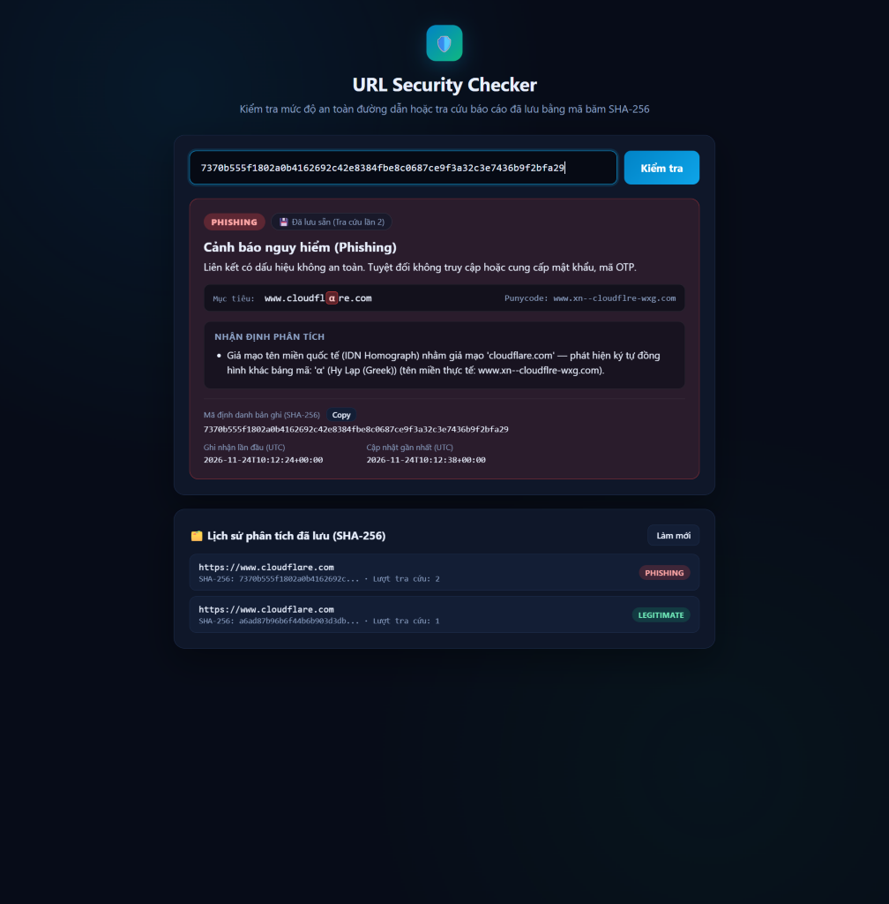

# URL Security — Machine Learning in URL Detection

Hệ thống kiểm tra mức độ an toàn của đường dẫn (Phishing / Legitimate) ứng dụng Học máy kết hợp phân tích cấu trúc tên miền, hỗ trợ lưu trữ và tra cứu nhanh lịch sử bản ghi qua mã băm `SHA-256`.



## Tài nguyên
- **Dataset**: https://www.kaggle.com/datasets/ndarvind/phiusiil-phishing-url-dataset
- **Google Drive**: https://drive.google.com/drive/u/1/folders/1uh-qkfegs4C7mHjJRMV7WXnLds2AVOvU
- **Colab Notebook**: https://colab.research.google.com/drive/1FES0v_ukQRNdw4bNZ7Bi8VvQHlxh6P3t?usp=sharing
- **Slide**: https://www.canva.com/design/DAHbPfWDpJA/-l8L6TY_B7c5B5_CVv8_8Q/edit

## Chạy nhanh
```bash
pip install -r requirements.txt
python app.py
```
Mở trình duyệt tại `http://127.0.0.1:8000`.
