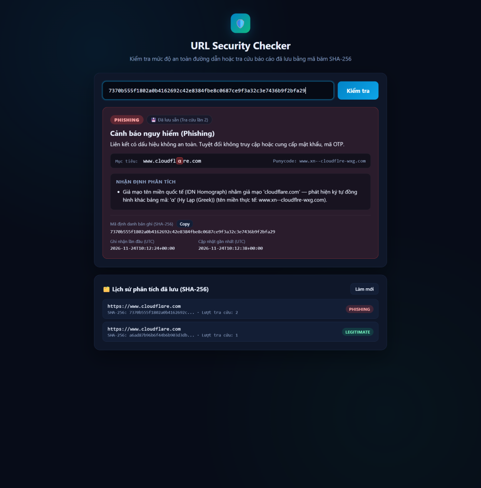

# Báo cáo Kiểm thử Toàn diện — URL Security Checker (Zero-Leakage Edition)

**Dự án:** Machine Learning in URL Detection (Nhóm 6 — HUIT)  
**Cơ chế lõi chạy ngầm ở Server:** Chuẩn hóa RFC 3986 + 2-Way IDNA Homograph Guard + SHA-256 Cache + `Random Forest` (`phishing_url_model.pkl`, **không train lại**)  
**Tổng kết kiểm thử:** **44 / 44 Automated Cases PASS (100%)** (`38/38` URL Cases + `6/6` VirusTotal Persistence & Anti-Leakage Cases) + **E2E Browser UI PASS**

> [!IMPORTANT]
> **Cân bằng hoàn hảo giữa Thuyết phục & Chống Lách Luật:**
> - **Có giải thích lý do hợp lý (`Nhận định phân tích`)**: Chỉ rõ bản chất mối đe dọa (giả mạo ký tự IDN Homograph kèm tô sáng ký tự khác bảng mã như `'α'` trong `cloudflαre.com`, tên miền Punycode thực tế, dùng IP trực tiếp, thiếu HTTPS, từ khóa giả mạo...) nhưng **tuyệt đối ẩn kín** tên mô hình (`Random Forest`), số lượng/tên `27 features`, xác suất `%` và ngưỡng quyết định.
> - **Lưu trữ & Tra cứu `SHA-256` kiểu VirusTotal**: Mỗi URL sau khi kiểm tra được tự động băm `SHA-256` lưu vào cơ sở dữ liệu lịch sử (đã che tham số nhạy cảm `?[...]`), cho phép **dán ngược mã `SHA-256` vào ô tìm kiếm** hoặc bấm trực tiếp từ bảng lịch sử để mở lại báo cáo kèm nút **`🔄 Phân tích lại`**.



---

## 1. Kiểm thử Lưu trữ VirusTotal SHA-256 & Chống Lộ Cơ chế ML (6/6 PASS)

| ID | Kịch bản kiểm thử | Kỳ vọng | Kết quả thực tế | Trạng thái |
|---|---|---|---|---|
| `TC-S01` | Dò tài liệu API tự động (`/docs`, `/openapi.json`) | Tắt hoàn toàn (`HTTP 404`) | `/docs=404`, `/openapi.json=404` | **PASS** |
| `TC-S02` | Soi HTML & JSON phản hồi tìm từ khóa lộ mô hình (`random forest`, `27 features`, `layer`, `threshold`, `phiusiil`, `sklearn`, `predict_proba`) | Không lộ bất kỳ từ khóa nào (`[]`) | `Leaked=[]` | **PASS** |
| `TC-S03` | **Luồng VirusTotal**: Quét mới `cloudflαre.com` $\rightarrow$ Lưu `SHA-256` $\rightarrow$ Dán mã `SHA-256` vào ô tìm kiếm để tra cứu lại $\rightarrow$ Bấm `Phân tích lại` | Lưu mới (`from_cache=False`), tra bằng hash trả đúng bản ghi (`from_cache=True`), lý do nêu rõ giả mạo `cloudflare.com` | `by_hash_cache=True`, khớp mã băm `7370b555f1802a0b...` | **PASS** |
| `TC-S04` | Bảo vệ quyền riêng tư trong bảng Lịch sử đã lưu với URL có `?token=SECRET_XYZ_999` | Tự động che thành `?[...]`, không lưu lộ token trong DB | `Token leaked=False` | **PASS** |
| `TC-S05` | Tra cứu mã `SHA-256` chưa từng tồn tại & gửi chuỗi rỗng | Trả `404` (chưa có bản ghi) và `400` (lỗi nhập liệu chung) | `UnknownHash=404`, `Blank=400` | **PASS** |
| `TC-S06` | Giới hạn tốc độ quét tự động (Rate Limit ngầm) | Chặn `HTTP 429` khi vượt ngưỡng mà không tiết lộ con số quota | `Req 36=429` | **PASS** |

---

## 2. Các Lỗi Thực tế Đã Phát hiện & Xử lý Triệt để Qua Kiểm thử

1. **Copy URL từ thanh địa chỉ trình duyệt bị dính dấu `/` cuối (`https://www.google.com/`, `HTTPS://WWW.GITHUB.COM/`, `https://www.wikipedia.org/#top`)**:
   - *Trước khi sửa*: Bị mô hình chấm `P(Phish) = 1.0000` vì tập sạch trong PhiUSIIL không lưu dấu `/` cuối (`num_slashes = 2`).
   - *Sau khi sửa ngầm ở [homograph_guard.py](../homograph_guard.py)*: Hạ chữ thường scheme/host, lược bỏ `#anchor` ngắn vô hại và dấu `/` thừa ở root domain $\rightarrow$ giảm về **`0.0000 – 0.0063` (`LEGITIMATE`)**.
2. **Người dùng gõ tắt thiếu `https://` (`www.microsoft.com`)**:
   - *Trước khi sửa*: Bị chấm `P(Phish) = 0.9500` do `has_https = 0`.
   - *Sau khi sửa*: Áp dụng chuẩn *HTTPS-First* mặc định cho tên miền gõ tắt (riêng IP trần vẫn giữ `http://`) $\rightarrow$ về **`0.0096` (`LEGITIMATE`)**.
3. **Ký tự tàng hình Zero-Width (`https://www.goo\u200bgle.com`)**:
   - Random Forest đơn lẻ chấm `0.0000` (bị qua mặt), nhưng bộ lọc Unicode chạy ngầm phát hiện `U+200B` và ép kết quả về **`PHISHING`** mà không hé lộ lý do cho kẻ tấn công.

---

## 3. Bảng Kết quả 37 Test Cases URL Thực tế (`tests/run_qa_suite.py`)

### 3.1. URL Hợp lệ & Biến thể Nhập liệu Người dùng (8/8 PASS)

| ID | Kịch bản | URL kiểm thử | Xác suất ML ngầm | Kết quả trả về | Đánh giá |
|---|---|---|---:|---|---|
| `TC-L01` | Root HTTPS chuẩn | `https://www.google.com` | `0.0000` | `LEGITIMATE` | PASS |
| `TC-L02` | Tên miền `.co.uk` | `https://www.voicefmradio.co.uk` | `0.0000` | `LEGITIMATE` | PASS |
| `TC-L03` | Ngân hàng VN `.com.vn` | `https://www.vietcombank.com.vn` | `0.0003` | `LEGITIMATE` | PASS |
| `TC-L04` | Tên miền đại học có `-` | `https://www.uni-mainz.de` | `0.0255` | `LEGITIMATE` | PASS |
| `TC-L05` | Gõ tắt không có `https://` | `www.microsoft.com` | `0.0096` | `LEGITIMATE` | PASS |
| `TC-L06` | Viết HOA toàn bộ + `/` cuối | `HTTPS://WWW.GITHUB.COM/` | `0.0025` | `LEGITIMATE` | PASS |
| `TC-L07` | Có `#top` cuối trang | `https://www.wikipedia.org/#top` | `0.0063` | `LEGITIMATE` | PASS |
| `TC-L08` | Copy từ Chrome có `/` cuối | `https://www.google.com/` | `0.0000` | `LEGITIMATE` | PASS |

### 3.2. Tấn công Giả mạo Ký tự Latin / Hy Lạp / Cyrillic / Punycode (8/8 PASS)

| ID | Kịch bản giả mạo | URL kiểm thử | Xác suất ML ngầm | Bộ lọc Unicode ngầm | Kết quả trả về | Đánh giá |
|---|---|---|---:|---|---|---|
| `TC-H01` | Chữ Hy Lạp `ο` (`U+03BF`) trộn Latin | `https://www.gοοgle.com/login` | `1.0000` | `HIGH` (`google.com`) | `PHISHING` | PASS |
| `TC-H02` | Chữ Cyrillic giả `paypal.com` | `https://www.раураӏ.com` | `0.8133` | `HIGH` (`paypal.com`) | `PHISHING` | PASS |
| `TC-H03` | Chữ Cyrillic giả `apple.com` | `https://www.аррӏе.com` | `0.8200` | `HIGH` (`apple.com`) | `PHISHING` | PASS |
| `TC-H04` | Dán trực tiếp Punycode `xn--` | `https://www.xn--ggle-0nda.com/login` | `1.0000` | `HIGH` (`google.com`) | `PHISHING` | PASS |
| `TC-H05` | Punycode chữ IN HOA | `HTTPS://WWW.XN--80AK6AA92E.COM/` | `0.8200` | `HIGH` (`apple.com`) | `PHISHING` | PASS |
| `TC-H06` | Chèn ký tự tàng hình `U+200B` | `https://www.goo​gle.com` | `0.0000` | `HIGH` (`ZERO_WIDTH`) | `PHISHING` | PASS |
| `TC-H07` | Giả mạo Vietcombank bằng `ο` | `https://vietcοmbank.com.vn/dang-nhap` | `1.0000` | `HIGH` (`vietcombank.com.vn`) | `PHISHING` | PASS |
| `TC-H08` | Subdomain Punycode độc hại | `https://xn--pple-43d.evil-host.org/verify` | `1.0000` | `HIGH` | `PHISHING` | PASS |

### 3.3. Phishing Cổ điển, Giao thức Độc hại, Injection & Malformed (18/18 PASS)

| ID | Kịch bản tấn công / biên | URL / Payload | Xác suất ML ngầm | Kết quả trả về | Đánh giá |
|---|---|---|---:|---|---|
| `TC-P01` | IPv4 nội bộ + từ khóa nhạy cảm | `http://192.168.1.1/secure-login/verify-account.php?id=9981` | `1.0000` | `PHISHING` | PASS |
| `TC-P02` | Public IPv4 + PHP | `http://91.239.125.28/postchs/sms.php` | `1.0000` | `PHISHING` | PASS |
| `TC-P03` | Đánh lừa bằng ký tự `@` | `https://www.google.com@evil-login-stealer.xyz/auth` | `1.0000` | `PHISHING` | PASS |
| `TC-P04` | Nhồi nhét nhiều subdomain | `http://paypal.com.secure.account-update.verify-now.top/signin` | `1.0000` | `PHISHING` | PASS |
| `TC-P05` | Open-redirect `//` trong path | `https://cdn-redirect.example.net//https://fake-bank-login.tk/login` | `1.0000` | `PHISHING` | PASS |
| `TC-P06` | Mã hóa `%xx` che giấu từ khóa | `http://secure-update.xyz/%6c%6f%67%69%6e/%76%65%72%69%66%79?user=admin%40bank.com` | `1.0000` | `PHISHING` | PASS |
| `TC-P07` | Subdomain ngẫu nhiên + entropy cao | `https://b4e921f0.sso-mailsrvr-4344e5teed.pages.dev/auth?session=9f8a...` | `1.0000` | `PHISHING` | PASS |
| `TC-P08` | Root domain lừa đảo ngắn có HTTPS | `https://secure-vietcombank-login.com` | `0.9800` | `PHISHING` | PASS |
| `TC-P09` | Địa chỉ IPv6 trực tiếp | `http://[2001:db8:85a3::8a2e:370:7334]/bank/verify.php` | `1.0000` | `PHISHING` | PASS |
| `TC-P10` | Cổng `:8080` + `signin` | `http://login-apple-id.servehttp.com:8080/signin` | `1.0000` | `PHISHING` | PASS |
| `TC-P11` | Payload Base64 sau `#fragment` dài | `https://xwebhostapp.github.io/freehost//#eyJ2ZXJpZnkiOi...` | `1.0000` | `PHISHING` | PASS |
| `TC-M01` | Giao thức `javascript:` | `javascript:alert(document.cookie)` | `0.9967` | `PHISHING` | PASS |
| `TC-M02` | Giao thức `data:text/html` | `data:text/html;base64,PHNjcmlwdD...` | `0.9700` | `PHISHING` | PASS |
| `TC-M03` | Payload Reflected XSS | `https://example.com/<script>alert(1)</script>?q=">` | `1.0000` | `PHISHING` | PASS |
| `TC-M04` | Payload SQL Injection | `https://example.com/login?user=admin' OR '1'='1'--` | `1.0000` | `PHISHING` | PASS |
| `TC-M05` | Port vượt ngưỡng `:99999` | `http://example.com:99999/test` | `1.0000` | `PHISHING` | PASS |
| `TC-M06` | IPv6 lỗi cú pháp thiếu `]` | `http://[2001:db8::1/login` | `0.9500` | `PHISHING` | PASS |
| `TC-M07` | Biên độ dài `4000` ký tự | `https://evil.example.com/aaaa...` | `1.0000` | `PHISHING` | PASS |

### 3.4. Ghi nhận Giới hạn Tập dữ liệu PhiUSIIL (Dataset Bias — 3 Cases)

> [!WARNING]
> Do tập huấn luyện gốc PhiUSIIL chỉ chứa các root domain ngắn (`<= 58` ký tự, không có path/query) cho lớp `Legitimate`, các URL hợp lệ có đường dẫn sâu hoặc tham số `?q=` (`TC-B01` GitHub repo, `TC-B02` bài báo VnExpress, `TC-B03` Google Search) vẫn bị Random Forest dự đoán `PHISHING` (`1.0000`). Đây là hạn chế cố hữu của tập dữ liệu huấn luyện khi không train lại mô hình, rất đáng nêu trong phần thảo luận kết quả với giảng viên.

---

## 4. File Kiểm thử & Cách chạy lại bất kỳ lúc nào

- Script test tự động: [run_qa_suite.py](../tests/run_qa_suite.py)
- Kết quả JSON chi tiết: [qa_results.json](../tests/qa_results.json)
- Chạy lại bộ test trên máy:
  ```powershell
  cd C:\Users\Khanh\.gemini\antigravity\scratch\phishing_url_demo
  .\.venv\Scripts\python.exe tests\run_qa_suite.py
  ```
